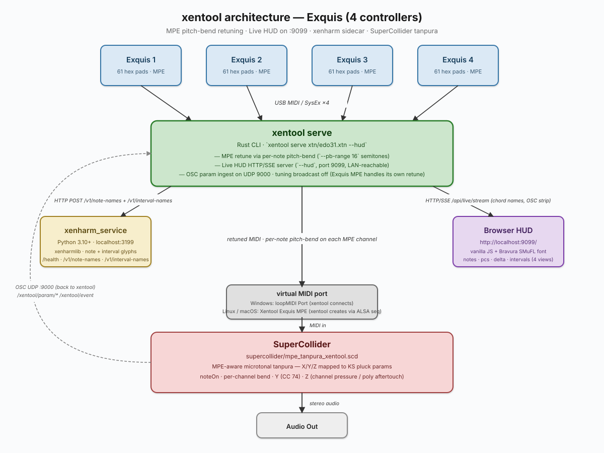
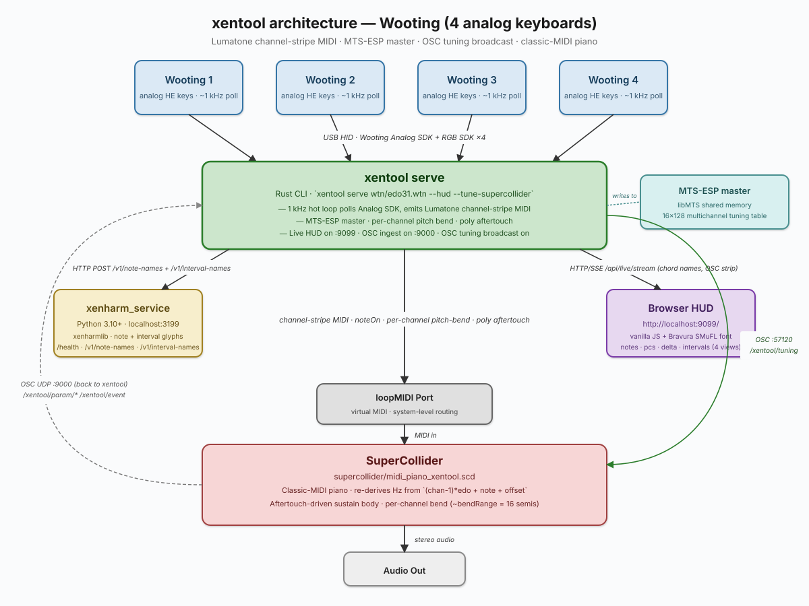

# xentool

A microtonal-tuning bridge for two expressive MIDI controllers:

- **Exquis** — Intuitive Instruments' 61-pad MPE hex grid (single or multi-board).
- **Wooting** — analog gaming keyboards repurposed as a velocity- and
  pressure-sensitive isomorphic controller (the [xenwooting](https://github.com/mcleinn/xenwooting)
  use case).

Plug the controller into your computer, point xentool at a layout file
(`.xtn` or `.wtn`), and any MIDI synth on the other end plays in any
EDO you like — 12, 24, 31, 53, your choice. xentool handles the
microtonal retuning, LED colours, expressive MPE / aftertouch routing,
and the live overview.

It runs on Windows, Linux (including Patchbox OS / Raspberry Pi), and
macOS.

---

## Features

**Play microtonally with any synth**

- Pitch-bend retuning for the Exquis (works with any MPE synth).
- MTS-ESP master for the Wooting (works with any MTS-ESP-aware synth
  — Pianoteq, amsynth_multichannel, …).
- Stays in stock 12-TET if you load a 12-EDO layout — no quirks.

**Live overview as you play**

- **Live HUD** in the browser: notes / pitch-classes / intervals /
  chord names with proper Bravura microtonal accidentals — auto-fits
  the screen, LAN-reachable from a phone or tablet, four taps cycle
  the views.
- Bundled chord database with 844 chord templates from Manuel Op de
  Coul's Scala project.

**Touchscreen studio for the bundled synths**

- **Tanpura studio** (Exquis backend, port 9100) tweaks the included
  microtonal tanpura: drone, jawari, EQ, Y-axis effect (resonant LPF
  wah, formant, tremolo, comb), reverb, master.
- **Piano studio** (Wooting backend, port 9101) tweaks the included
  piano patch: voice mode (piano / Hammond organ / Rhodes EP), ADSR,
  three-string detune, drone, Y-axis effect (LPF / tremolo / Leslie
  / chorus / vibrato), reverb.
- Both UIs share the same shape: big sliders, accordion sections,
  Save / Load presets, "Make default" so your sound boots that way
  next time, "Factory reset" to roll back. Fast and finger-friendly.

**Layouts**

- Visual web editor for `.xtn` / `.wtn` / `.otn` / `.ltn` (Lumatone) files —
  paint pads, set tunings, import other layouts, rotate, translate,
  save.
- Multi-board for Exquis (up to 4 boards in one stack).
- Per-pad colours stored alongside the tuning.

**Optional bundled sounds** under `supercollider/`:

- Microtonal tanpura SynthDef (Exquis MPE), with all the Indian-string
  expressivity the studio UI exposes.
- Multi-voice piano / organ / Rhodes EP SynthDef (Wooting),
  pitch-derived from the layout's EDO so it stays in tune without
  needing an MTS-ESP client.

---

## How it fits together

A typical Exquis setup — controller → xentool → virtual MIDI port →
your synth, with the optional Live HUD, xenharm sidecar, bundled
SuperCollider tanpura, and tanpura studio touchscreen UI:



The Wooting setup is the same shape, but the analog keys go through
a 1 kHz polling loop and tuning is published over MTS-ESP plus an
OSC tuning broadcast to SC. The bundled piano patch and piano studio
sit in the same place the tanpura ones do for Exquis:



You don't need every box — the Live HUD, xenharm, SuperCollider, and
the studio UI are all optional. Even the bundled SC patches are
optional: any MPE / MTS-ESP synth on the other side of the virtual
MIDI port works.

---

## Install

Pick the install path that matches your OS, then jump to
[Quick start](#quick-start).

### Linux (Patchbox OS, Raspberry Pi OS, Ubuntu on Pi 4/5)

Each script is **interactive**: it shows the plan up front, prompts
before each component, and only installs what you accept.

```bash
# Exquis MPE controller:
bash scripts/install-linux-exquis.sh

# Wooting analog keyboard (also installs the Wooting Analog + RGB SDKs):
bash scripts/install-linux-wooting.sh
```

Either script will offer to install:

1. Build prerequisites and Rust, then build `xentool` to `~/.cargo/bin/`.
2. (Wooting only) the Wooting Analog + RGB SDKs.
3. The **xenharm** Python sidecar (microtonal note glyphs in the HUD).
4. **SuperCollider** with the matching bundled patch.
5. The matching **studio web UI** (tanpura or piano).
6. The optional **xentool web editor** service.
7. `systemd --user` units (`xenharm`, `xentool`, optionally
   `xentool-supercollider`, optionally `xentool-studio`, optionally
   `xentool-edit`) so it all starts on boot.

Notes for Linux users:

- On ALSA systems, each physical **Exquis** board may appear as two MIDI
  ports (`Exquis MIDI 1` and `Exquis MIDI 2`). xentool groups those
  ports into one logical board automatically.
- If the installer's Python / `venv` detection picks a Python build that
  cannot install `xenharmlib`, use a Python 3.12 install with working
  `venv` support, then re-run the installer.
- On Linux, the **Wooting** backend can optionally mirror its outgoing MIDI
  stream to a JACK MIDI port for MODEP / other JACK hosts:
  `xentool serve mylayout.wtn --jack-midi-mirror`
  The normal xentool virtual MIDI port remains active; the JACK port is an
  extra mirror, not a replacement.

After install:

| What you want to do                              | Command                                              |
|--------------------------------------------------|------------------------------------------------------|
| Open the **Live HUD**                            | <http://localhost:9099/>                             |
| Open the **studio web UI** (if installed)        | <http://localhost:9100/> (Exquis) · <http://localhost:9101/> (Wooting) |
| Open the **layout editor** (if installed)        | <http://localhost:8088/>                             |
| Attach to xentool's **TUI** (detach: `Ctrl-b d`) | `xentool-tui`                                        |
| Tail logs                                        | `journalctl --user -u xentool -f`                    |
| Manage the service                               | `systemctl --user {status,restart,stop} xentool`     |

If you front xentool with a reverse proxy, the web UIs work cleanly from
subpaths as well. Example Caddy paths:

- Live HUD: `/xtn/`
- Layout editor: `/xtn/edit/`
- Tanpura studio: `/xtn/studio/`

### Windows

```powershell
# build + install:
cargo install --path .

# Wooting SDKs (only needed for the Wooting backend):
powershell -ExecutionPolicy Bypass -File scripts\install-wooting-sdks.ps1
```

Or run `scripts\install.bat` for the equivalent.

#### One-click full stack

To bring up xentool, the xenharm sidecar, the matching SuperCollider
synth, and the matching studio web UI in **one** Windows Terminal
window — four labelled tabs, started with the right delays — pick
the script for your hardware and double-click:

| Hardware | Script                          | Default layout    | Bundled sound + studio                    |
|----------|---------------------------------|-------------------|-------------------------------------------|
| Exquis   | `scripts\run-all-exquis.bat`    | `xtn\edo31.xtn`   | tanpura + tanpura studio (port 9100)      |
| Wooting  | `scripts\run-all-wooting.bat`   | `wtn\edo31.wtn`   | piano + piano studio (port 9101)          |

Falls back to separate cmd windows if Windows Terminal isn't installed.
Override the layout or SC patch by setting `LAYOUT` / `SC_SCRIPT`
before launching:

```powershell
set LAYOUT=C:\Dev-Free\xentool\xtn\edo24.xtn
scripts\run-all-exquis.bat
```

To stop one subsystem, focus its tab and press Ctrl-C; to stop
everything, close the window.

### macOS

```bash
cargo install --path .
```

The Wooting SDKs aren't auto-installed on macOS — build them from
upstream sources if you need the Wooting backend.

### Build from source (any platform)

```bash
cargo build           # debug
cargo build --release # release
cargo test            # full test suite
```

---

### Android (Termux) — experimental, Exquis only

Tested on a Pixel 7 with the Exquis plugged straight into USB-C. Termux has
no MIDI ports at all (no ALSA sequencer, midir has no Android backend), so
the Android build differs in two ways:

- the Exquis is driven as a raw USB-MIDI class device through libusb on a
  file descriptor handed over by `termux-usb`. xentool does this itself:
  any command that needs the device re-executes under `termux-usb`
  (accept the USB permission dialog once per plug-in). Only one Exquis is
  supported.
- the retuned MIDI stream goes to SuperCollider as OSC
  (`--output osc://127.0.0.1:57120` is the Android default). The bundled
  patches load `supercollider/xentool_osc_midi.scd`, which feeds those
  messages into the usual MIDIdefs.

- scsynth's audio goes through JACK's `dummy` backend and a tiny bridge
  (`scripts/termux/jack2pulse.c`) into PulseAudio, because jack2's own
  OpenSL ES backend crackles at every period size.

```bash
# plus the Termux:API companion app from the same source as Termux
pkg install git
git clone https://github.com/mcleinn/xentool.git ~/dev/xentool
cd ~/dev/xentool
bash scripts/install-termux-exquis.sh         # packages, cargo build --release, audio bridge
scripts/run-termux-exquis.sh                  # xtn/edo53.xtn; jackd + bridge + sclang + xentool serve in tmux
scripts/run-termux-exquis.sh xtn/edo31.xtn    # another layout
```

| Script | Role |
|--------|------|
| `scripts/install-termux-exquis.sh` | one-off install, counterpart of `install-linux-exquis.sh` (no services, no autostart) |
| `scripts/run-termux-exquis.sh` | counterpart of `run-all-exquis.bat`: tmux session with jackd, audio bridge, sclang, `xentool serve --hud --no-tui` |

Full write-up of every Android-specific change: [docs/android_termux.md](docs/android_termux.md).

Not available on Android: MTS-ESP, the Wooting backend (no SDK), multiple
Exquis boards, the xenharm sidecar (untested).

## Quick start

1. Plug in your Exquis or Wooting.
2. Pick a layout from `xtn/` or `wtn/` (e.g. `edo31.xtn`) and run:
   ```
   xentool serve xtn/edo31.xtn --hud
   ```
3. Point your synth at xentool's MIDI output (see
   [Synth compatibility](#synth-compatibility)).
4. Open <http://localhost:9099/> for the Live HUD.
5. (Optional) open <http://localhost:9100/> (Exquis) or
   <http://localhost:9101/> (Wooting) for the touchscreen studio if
   you're using the bundled SC patch.
6. Play.

---

## Live HUD

Add `--hud` to any `xentool serve` command. Starts a small HTTP server
(default `0.0.0.0:9099` so phones and tablets on the LAN can connect)
and a browser-based view that shows currently-played notes in proper
musical notation with the Bravura SMuFL font. Auto-fits the viewport,
dark, no chrome.

Tap or click anywhere to cycle four views:

| View        | Shows                                                                       |
|-------------|------------------------------------------------------------------------------|
| `notes`     | pressed pitches as Bravura glyphs (with up/down arrow microtonal accidentals) |
| `pcs`       | one entry per pitch class (`14₃-21₃-3₄`)                                     |
| `delta`     | root pitch + `+N` step offsets to the other notes                            |
| `intervals` | chord-name candidates from the bundled Scala chord database                  |

For full microtonal note names you also need the **xenharm** sidecar
(installed automatically on Linux when prompted; manual setup on
Windows/macOS — see [`xenharm_service/`](xenharm_service/)). Without
it, the HUD falls back to numeric labels.

Tap a single note glyph to cycle its enharmonic spellings (e.g.
sharp ↔ flat). Tap empty space to cycle the four views.

---

## Studio touchscreen web UI

Each backend ships with a small web UI that exposes the bundled
SuperCollider synth's parameters as touch-friendly sliders and
dropdowns, with live updates to held notes via OSC.

| Backend  | UI                  | URL                       | Synth target                  |
|----------|---------------------|---------------------------|-------------------------------|
| Exquis   | **tanpura studio**  | <http://localhost:9100/>  | `mpe_tanpura_xentool.scd`     |
| Wooting  | **piano studio**    | <http://localhost:9101/>  | `midi_piano_xentool.scd`      |

Both UIs share a layout: accordion sections of sliders / dropdowns,
big finger-sized targets, and four header buttons:

- **Save preset** — writes a timestamped snapshot to `presets/`.
- **Load** — pick a saved preset; values apply atomically.
- **Make default** — promotes the current state to `_default.json`.
  On next startup, those values load automatically. **Reset** also
  goes there.
- **Factory reset** — deletes `_default.json` and rolls back to the
  hardcoded patch defaults.

Slider moves are pushed live to every currently-held voice, so you
can hold a chord and reshape its sound in real time.

**What the tanpura studio exposes:** decay / damp / brightness for
the strings, drone amount + type (CombL feedback / Sine + harmonics
/ Saw / Triangle / Beating sines / Pulse), jawari nonlinearity (mix
+ drive + mode), sympathy delay, Y-axis effect (EQ shelves /
resonant LPF wah / bandpass formant / tremolo / pluck-position
comb), press swell range, limiter, reverb, master.

**What the piano studio exposes:** voice (piano / Hammond organ /
Rhodes EP), ADSR, piano string detune (0 = unison → 0.01 ≈
honky-tonk), hammer hardness, drone amount + type, Y-axis effect
(off / LPF / tremolo / Leslie / chorus / vibrato), Leslie speeds,
reverb, master.

The Linux installer offers to set up the matching studio as a
systemd user service. The Windows `run-all-*.bat` launchers open it
as the 4th tab in their stack.

---

## Synth compatibility

xentool is **synth-agnostic** — it produces standard MIDI on a virtual
MIDI port (loopMIDI on Windows, snd-seq on Linux). Any synth that
reads from that port can be the audio engine.

| Backend  | Target synth                                                | Synth pitch-bend range                                 | How microtones reach the synth                                                          |
|----------|-------------------------------------------------------------|-------------------------------------------------------:|------------------------------------------------------------------------------------------|
| Exquis   | any **MPE-capable** synth                                   | **±16 semitones** *(must match `--pb-range`)*          | per-note pitch-bend injected before each note-on                                         |
| Wooting  | any **MTS-ESP master client with multichannel tuning**      | user's choice (e.g. ±2 for piano, ±12 for organ)       | xentool registers as MTS-ESP master and pushes a 16×128 multichannel tuning table        |

On Linux, `xentool serve file.wtn --jack-midi-mirror` also creates a JACK
MIDI output named `Xentool Wooting` so MODEP / JACK hosts can subscribe
directly, while the normal xentool virtual MIDI port stays available for
ALSA-seq clients.

For the **Exquis** flow, point any MPE synth (Pianoteq, Equator2,
MPE-aware Surge XT, amsynth_multichannel, …) at xentool's MIDI output
and set its **per-note pitch-bend range to ±16 semitones** to match
the default. xentool's microtonal retunes ride on the bend channel,
so the synth-side range must match exactly.

For the **Wooting** flow, point any MTS-ESP master client *with
multichannel tuning support* at xentool's output. Single-channel
MTS-ESP-only synths will read the wrong frequencies because the
Lumatone-style channel-stripes assign different pitches to the same
MIDI note number on different channels.

If microtones aren't desired, just pick `xtn/edo12.xtn` /
`wtn/edo12.wtn` — the synth then receives ordinary chromatic MIDI.

### Optional bundled SuperCollider sounds

For quick testing without configuring an external synth:

| Patch                      | Backend  | What it is                                                                                |
|----------------------------|----------|-------------------------------------------------------------------------------------------|
| `mpe_tanpura_xentool.scd`  | Exquis   | MPE microtonal tanpura · X/Y/Z → KS pluck params                                          |
| `midi_piano_xentool.scd`   | Wooting  | Multi-voice piano / organ / Rhodes EP · re-derives Hz from the layout's EDO (no MTS-ESP)  |

Both can be tweaked live via their studios (above). Both also push
parameter changes back to the HUD via OSC, so encoder turns and
button presses appear as a sticky parameter strip + brief event log
on the right edge of the HUD page.

---

## Layout editor

```
xentool edit xtn/edo31.xtn           # Exquis
xentool edit wtn/edo31.wtn           # Wooting
xentool edit otn/edo53.otn           # openxen (also a Lumatone .ltn)
xentool edit xtn/edo31.xtn --open    # also auto-open in your default browser
```

Starts a local HTTP editor on port 8088 (override with `--port`).
Open the URL printed on stdout, or pass `--open` to launch your
default browser automatically. A file that does not exist yet starts
as a blank layout of the kind its extension says and is created by
the first save.

The editor is the same for every keyboard. It asks xentool's central
geometry (`xentool geometries`) for the keyboard of the open file and
draws what it gets: every board in one keyfield (Combined) or board by
board (Individual), keys as hexagons at their place in the hex
lattice, or as keycaps where the keyboard has them (Wooting). An
`.otn` shows the five Lumatone modules of 56 keys in their real
arrangement. Key / Chan / Colour are edited in the sidebar (`Chan 0`
switches a key off, it then shows `–`), Edo and PitchOffset in the top
bar.

**Save** changes only the lines of the file whose value changed. A save
without changes leaves the file byte for byte as it was; comments,
line ends, the notation of colours and entries the editor does not
know (`KTyp_n`, velocity tables of a Lumatone file, ..) stay. Keys and
boards are never deleted by a save. A value that would not load (Key
above 127, Chan above 16, a colour that is not `RRGGBB`) is refused.

**Generators** (sidebar): a layout that is the same everywhere is given
by two steps, one key to the right (Gen A) and one key up-right
(Gen B), from a base key. *Guess from layout* finds them, *Verify*
marks the keys that are off or unset (grey) and the keys that do not
follow (red), *Repair* fills exactly those and leaves the rest. A
filled key gets the colour that keys of the same pitch class have, and
is written the way the layout writes its pitches (octaves by channel
where every Key is below Edo; otherwise the channel of its board, or
the nearest channel on which the Key fits 0-127). A key whose pitch no
channel holds is left and counted.

**Import**: pick a `.ltn` (Lumatone), `.otn`, `.wtn` or `.xtn`.

- A file for the same keyboard as the open one (a `.ltn` or `.otn`
  into an `.otn`, `.wtn` into `.wtn`, `.xtn` into `.xtn`) is taken over
  one to one: board n stays board n, key k stays key k, with Key, Chan
  and Colour. Edo and PitchOffset come from the import if it has them;
  a plain Lumatone file has neither, then the open layout's values
  stay and the page says so (set Edo before saving). Boards the import
  lacks stay as they are. Keys a Lumatone file marks as disabled
  (`KTyp` 0 or 4) are switched off; everything else of a Lumatone file
  (`KTyp`, `CCInvert`, global settings) is not part of a layout and is
  not taken over. Without the browser:
  `xentool new out.otn --from in.ltn --edo 31`.
- A file for another keyboard is laid over the open one: arrow keys
  move it, `R` turns it 60° around the hovered key, Enter applies,
  Esc cancels.

## File-extension routing

A single `xentool` binary handles all backends — the file extension
picks the backend:

| Extension | Backend | Layout format              |
| --------- | ------- | -------------------------- |
| `.xtn`    | Exquis  | xentool-native (INI)       |
| `.wtn`    | Wooting | xenwooting (INI)           |
| `.otn`    | openxen | Lumatone-style (INI) with `Edo=` |
| `.ltn`    | openxen | Lumatone; needs an `Edo=` line to be played, `edit` opens it as it is |

So `xentool serve foo.xtn` runs the Exquis serve loop and `xentool
serve foo.wtn` runs the Wooting serve loop. Same for `load` / `new`.

---

## Exquis backend

### `xentool serve <file.xtn>` — microtonal tuning server

```
xentool serve xtn/edo31.xtn
xentool serve xtn/edo31.xtn --pb-range 48
xentool serve xtn/edo31.xtn --output "My MIDI Port"
xentool serve xtn/edo31.xtn --mts-esp
```

Loads the layout, sets pad colours on connected boards, and runs a
live microtonal tuning server with a terminal UI showing active
touches and tuning status.

Uses **pitch-bend retuning** by default: each MPE channel carries a
note plus a tiny per-note bend that shifts it to its exact microtonal
frequency. The synth's per-note pitch-bend range must match
`--pb-range` (default 16 semitones); otherwise the EDO quantisation
drifts. Pass `--mts-esp` to switch to MTS-ESP master mode instead
(one global 128-note table; one master per machine; max 128 unique
notes).

**Windows requires loopMIDI** — install
[loopMIDI](https://www.tobias-erichsen.de/software/loopmidi.html),
create a port named `loopMIDI Port`, and point your synth at it.

**Linux / macOS** — xentool creates its own subscribable virtual
MIDI port (`Xentool Exquis MPE`) via ALSA seq / CoreMIDI. No virtual
cable needed.

Multi-board: each board gets its own tuning state. Scales to 4+.

### `xentool list` / `xentool midi`

```
xentool list                                # all connected MIDI ports + Wooting devices
xentool midi                                # hybrid live MPE monitor
xentool midi --mode stream --mpe-only       # stream-of-events, MPE only
xentool midi --device 1 --log-file …        # JSONL logging
```

`xentool midi` shows active touches with live `X/Y/Z`, channel,
note, value — press `q` to quit. Every session also logs to JSONL
under `%LOCALAPPDATA%\xentool\logs\` (Windows) or `logs/` (Linux)
unless `--no-log`.

### Pad colours, dev mode, control LEDs

```
xentool pads fill amber                  # paint all pads
xentool pads clear
xentool pad 17 blue                      # paint one pad
xentool control settings red             # paint a control LED
xentool highlight 60                     # highlight pad 60 (firmware-green only)
xentool highlight --device 2 30 127      # light pad 30 on the 2nd Exquis
xentool highlight --device 2 30 0        # turn it off again
xentool dev on                           # explicit developer-mode control
xentool dev off
```

All pad colour commands use the **MPE-safe snapshot technique** by
default — colours appear without disabling pitch-bend / CC74 /
aftertouch. Pass `--legacy` to take over the pad zone in dev mode
instead (full LED freedom, but MPE expression turns off).

`xentool highlight <note> [velocity]` valid ranges:

- `<note>` — the Exquis has **61 pads numbered 0–60**, and xentool serve
  maps pad ID → MIDI note 1:1. Notes outside 0–60 are sent to the device
  but light nothing (no pad to land on). Notes 61–127 are accepted by the
  CLI but useless on the hardware.
- `[velocity]` — `1–127` turns the pad on (firmware fixes the colour to
  green; velocity does **not** affect colour), `0` turns it off.
- `--device <N>` — 1-indexed device number from `xentool list`. With
  multiple boards connected, omitting `--device` lights the pad on every
  board simultaneously (useful for "blink all" tests).

### `xentool load <file.xtn>` — paint LEDs from a layout

Loads an `.xtn` file (INI, compatible with `.wtn` / `.ltn`) and
applies per-pad colours. Each `[BoardN]` section maps to a logical
device name in `devices.json`. With one board section and one Exquis
connected, auto-matches without config.

Per-pad fields: `Key_N` (virtual MIDI note for the EDO calculation,
not sent to the device), `Chan_N` (virtual MIDI channel), `Col_N`
(hex RGB).

Frequency formula (used by `serve`):
```
virtual_pitch = (Chan - 1) × Edo + Key + PitchOffset
```

### Multi-Exquis device config

`devices.json` at `%LOCALAPPDATA%\xentool\config\devices.json` maps
logical board names to USB serial numbers:

```json
{
  "devices": {
    "board0": { "serial": "ABC123" },
    "board1": { "serial": "DEF456" }
  }
}
```

Auto-created/updated by `sync_boards()` on every `load`/`serve`
command — manual edits only needed to pin a preferred ordering.

---

## Wooting backend

The Wooting backend turns each analog key into a microtonal MIDI key
with continuous aftertouch. Loads the Wooting Analog + RGB SDKs at
runtime.

### `xentool serve <file.wtn>` — analog-to-MIDI server

```
xentool serve wtn/edo31.wtn
xentool serve wtn/edo31.wtn --output "loopMIDI Port"      # Windows
xentool serve wtn/edo31.wtn --output "Xentool Wooting"    # Linux
```

Loads the layout, paints LEDs, registers as MTS-ESP master, and runs
a 1 kHz polling hot loop that reads per-key analog depths and emits
velocity-mapped Note On/Off + continuous poly-pressure on a virtual
MIDI port. Terminal UI shows currently-held notes and event log;
press `q` to quit.

**MIDI output port:**

- **Windows:** xentool *connects to* a virtual cable. Install
  loopMIDI and create a port named `loopMIDI Port`.
- **Linux / macOS:** xentool *creates* its own subscribable port
  (`Xentool Wooting`). Override the name with `--output "<name>"`.

**Live in-keyboard controls** (key bindings on the Wooting itself):

| Key             | Action                                              |
| --------------- | --------------------------------------------------- |
| Right Alt       | Cycle aftertouch mode (speed → peak → off)          |
| Space (held)    | Octave hold (toggle per board)                       |
| Arrow Left/Right | Adjust press threshold *or* aftertouch speed max    |
| Arrow Down      | Cycle velocity profile (linear / gamma / log / inv-log) |
| Left Ctrl / Alt | Pitch bend up / down (analog → bend)                 |
| Left Meta       | Configurable analog CC                               |
| Context Menu    | Cycle to next `.wtn` file in `./wtn/`                |

A configurable idle screensaver blanks all LEDs (`screensaver_timeout_sec`
in `settings.json` → `wooting.rgb`); the next press wakes it (no
spurious note).

### `xentool new` / `xentool load`

```
xentool new my_layout.wtn --edo 31           # blank 4×14 grid
xentool load my_layout.wtn                   # paint LEDs
```

`.wtn` files are INI, structurally similar to `.xtn`. `[Board0]`
section per board, `Key_N` / `Chan_N` / `Col_N` per cell. xenwooting
files load directly — same format.

### Tuning behaviour

Wooting `serve` is **MTS-ESP only** — the synth must be an MTS-ESP
client with multichannel tuning (e.g. Pianoteq). Single-channel
MTS-ESP synths read the wrong frequencies.

Bend keys (Left Ctrl / Left Alt) emit raw 14-bit pitch-bend that
xentool relays without scaling, so the synth-side bend range is
your call: ±2 for pianistic feel, ±12 for organ portamento. The
bundled SC piano patch defaults to ±2.

---

## Pushing your own params to the HUD from any OSC client

xentool listens for OSC on UDP `9000` by default (override with
`--osc-port`). Send `/xentool/param/<group>/<name> <value> [<unit>]`
for a sticky parameter, or `/xentool/event <text>` for a one-off log
line. The bundled SC patches use this to surface synth state on the
HUD's right-edge strip.

```sclang
~hud = NetAddr("127.0.0.1", 9000);
~hud.sendMsg("/xentool/param/filter/cutoff", 880.0, "Hz");
~hud.sendMsg("/xentool/event", "preset → bright");
```

---

## Local control API (`serve --api`, all backends)

`xentool serve <file.otn, file.wtn or file.xtn> --api` (port `9098`, override with `--api-port`) lets another
program on the same machine follow and steer a playing session. The endpoints and the JSON
are the same for every keyboard; a client reads `/api/setup` and needs to know nothing else
about the device. It was built for the
openxen tutor, an MCP server through which a language model teaches at the keyboard, but it
knows nothing about tutoring. It listens on `127.0.0.1` only.

| Endpoint | |
|---|---|
| `GET /api/setup` | The keyboard as one keyfield: geometry and layout name, EDO, connected boards, the lattice offsets of the six neighbours, and for every playable key its address `(board, key)`, position in the shared hex lattice, pitch, frequency and layout colour |
| `GET /api/keys/state` | Keys held now |
| `GET /api/events?after=N&wait_ms=M` | Key presses and releases (with board and key, not only the pitch) and board changes numbered above `N`; waits up to `M` ms for the first one. Without `after`: the current number, to start "from now" |
| `POST /api/leds/overlay` | `{"clear": "all" \| [[board, key], ..], "set": [{"board", "key", "rgb": "RRGGBB"}, ..], "dim_base": 0..1}`: colours above the layout colours. Clearing a key shows its layout colour again |
| `POST /api/notes` | `{"on": [{"board", "key", "velocity", "ms"}], "off": [[board, key], ..]}`: sounds keys through the normal MIDI output, in the current tuning |
| `POST /api/midi` | `{"notes": [{"channel": 1..16, "note", "velocity", "ms"}]}`: notes sent as they are, outside the layout (metronome clicks on channel 10) |
| `GET /api/layouts` | Layout files next to the served one (name = file name without extension, EDO), the current one, and how the last switch went |
| `POST /api/layout` | `{"name"}`: load another of these layouts while serving (tuning, colours and `/api/setup` follow; a `setup` event is sent) |
| `POST /api/chords/name` | `{"edo", "pitch_classes": [..]}` → chord names per root (the HUD's chord list) |

While an overlay is shown, the module's own press highlight is switched off and the LED
screensaver is held off.

### Wooting keyboards

`xentool serve edo31.wtn --api` gives the same endpoints and JSON for Wooting keyboards
(`"backend": "wooting"`, `"geometry": "wooting"`). What is particular to them:

- **Key addresses.** `board` is the `.wtn` board, `key` the `.wtn` cell index (`Key_N`,
  row × 14 + column), as in the layout file and the editor. Only keys that play a note are
  listed: 53 per keyboard at most; the control bar, the arrow keys and cells without a
  channel are not part of the description and send no events.
- **One keyfield per pair.** Two keyboards (the first turned by 180°, above the second)
  share one lattice, so intervals continue from one to the other. A single keyboard is
  upright. With three or four keyboards the second pair lies to the right of the first with
  a gap; its place is a convention, not a measured position. When a keyboard is plugged in
  or pulled out, the others may change their orientation and board number; a `setup` event
  tells clients to read `/api/setup` again.
- **Octave hold.** The Space key of a keyboard raises all its notes by one octave. The
  pitches in `/api/setup` are the ones that sound with the holds as they are; every toggle
  sends a `setup` event (same `boards`, new pitches), and `/api/notes` sounds a key with the
  hold applied, like a press. Key events carry the pitch that was actually sent.
- **Overlay.** Overlay colours lie above everything `serve` paints itself (layout colours,
  the white flash of a pressed key, layout changes); clearing a key shows what `serve`
  painted there last. `dim_base` dims all other LEDs of all keyboards, including the control
  bar and the flash of pressed keys, which stays visible on keys without an overlay colour
  (the openxen modules switch their highlight off instead). While an overlay is shown the
  screensaver stays off; an API command wakes the LEDs without swallowing a key press.
- **Layouts.** `/api/layout` does what the layout key (ContextMenu) does; that key in turn
  now also updates `/api/setup`. The list comes from the folder of the layout being served.

### Exquis

`xentool serve edo31.xtn --api` gives the same endpoints and JSON for Exquis boards
(`"backend": "exquis"`, `"geometry": "exquis"`). What is particular to them:

- **Key addresses.** `board` is the number of the board (`board3` in `devices.json` =
  `[Board3]` in the `.xtn` file = 3), `key` the pad, 0..60 (pad 0 bottom left, rows counted
  away from the player). Boards keep their pinned number, so the connected ones can be
  0, 1 and 3. All 61 pads of a board that has a section in the layout are listed; a pad the
  file leaves out sounds as channel 1 with its pad number as key and is listed black. A
  connected board without a section is silent: it is in `boards` and has no keys.
- **One keyfield.** Board N lies N times `(-1, 11)` from board 0 in the lattice (one row
  lower, one board width to the right, the geometry `xentool geometry exquis` shows), so
  neighbouring boards continue each other's rows. A board that is not connected leaves its
  place empty: with boards 0, 1 and 3 no pad of board 3 is a neighbour of a pad of board 1.
- **Octave shift.** The Up/Down buttons shift a board by octaves. The pitches in
  `/api/setup` are the ones that sound with the shifts as they are; every shift sends a
  `setup` event (same `boards`, new pitches) and `/api/notes` sounds a pad shifted, like a
  press. A release event carries the pitch its press had. Loading a layout sets all shifts
  back to 0.
- **Colours.** The pads have 7 bit per colour channel. `color` in `/api/setup` is the pad's
  colour scaled back to 8 bit, which can differ from the file's value by one. Overlay
  colours get the colour correction of `serve` (`--gamma`, `--saturation`, `--rgb-gain`)
  like the layout colours.
- **Events.** A pad's note-on and note-off, with its velocity. The pad's X, Y and Z
  movement is not part of the API.
- **Notes (pitch-bend mode).** The output is an MPE stream: every note has a channel of
  its own, bent to its pitch. An `/api/notes` note takes a member channel (2..15, from 15
  downwards) that no pad of any board and no other API note is using, and goes through the
  board's retuning like a touch of that pad: the same bend, the same note. If a touch
  arrives on that channel while the API note sounds, the API note ends first. With all
  fourteen channels held by fingers the note is dropped. `/api/midi` notes go out as they
  are; channel 10 is one of the MPE member channels here, so a click on it is played by
  the MPE synth with whatever bend that channel last had. A metronome is better served by
  a channel the synth treats separately, if it has one.
- **With `--mts-esp`** xentool has no MIDI output (the synth listens to the Exquis
  itself): `/api/notes` and `/api/midi` answer `501` with the reason. Everything else works.
- **Overlay.** The Exquis takes pad colours only as a snapshot of all 61 pads of a board
  (262 bytes; single pads cannot be set without losing MPE). So an overlay change costs one
  snapshot for every board whose pads change: one board for a hint, all boards when
  `dim_base` starts or ends. A board gets at most one snapshot every 50 ms; changes in
  between are merged, and a board that already shows the right colours gets nothing.
  Layout changes repaint under the overlay; loading another layout clears the overlay.
  When `serve` ends, the pads show the layout colours again (not after a kill).
- **Layouts.** `/api/layout` does what the Settings button does, with the layout named
  instead of the next one; the Settings button in turn now also updates `/api/setup`. The
  list comes from the folder of the layout being served.
- **Boards come and go only at start.** The Exquis backend looks for boards once, when
  `serve` starts; `boards` does not change while it runs.
- **Timing.** With `--api` the serve loop looks for API commands every 2 ms (without
  it the loop wakes for MIDI messages and otherwise every 40 ms). Demonstration notes and
  clicks start and end with that resolution.

---

## Technical reference

### Pitch-bend retuning (Exquis serve, default)

For each pad, the exact target frequency is computed from the .xtn's
`Key_N` / `Chan_N` and the `Edo` value. The nearest 12-TET MIDI
note is chosen and the pitch-bend offset to reach the exact
microtonal frequency is calculated. On each `note_on`, a pitch-bend
message is injected before the `note_on` on the same MIDI channel.
Player X-axis bends are added to the tuning offset; Y (CC74) and Z
(channel pressure / poly aftertouch) pass through unchanged.

### MTS-ESP master (Exquis `--mts-esp` and Wooting `serve`)

For the Wooting flow xentool publishes both:

- a global 128-note tuning table (for non-multichannel-aware clients),
- a 16×128 multichannel tuning table — one full 128-note table per
  MIDI channel, required because Lumatone-style channel-stripes
  assign different absolute pitches to the same MIDI note number on
  different channels.

Loaded at runtime from `LIBMTS.dll` on Windows, `libMTS.so` /
`libMTS.dylib` elsewhere.

### Snapshot LED technique (Exquis)

The Exquis developer-mode API requires taking over the pad zone to
set LED colours, which **disables MPE output**. The Snapshot command
(`09h`) sidesteps this: enter dev mode for non-pad zones only (mask
`0x3A`), then send a 262-byte snapshot SysEx that encodes both MIDI
note mappings and RGB colours for all 61 pads. Pads stay in normal
mode, so MPE is preserved.

This is the default for `pad`, `pads fill`, `pads clear`, `pads test`.
Pass `--legacy` to fall back to direct dev-mode takeover (loses MPE).
Discovered via [PitchGridRack](https://github.com/peterjungx/PitchGridRack).

### `--tune-supercollider` (Wooting flow)

SuperCollider has no MTS-ESP client, so on the Wooting flow xentool
also broadcasts the active tuning to UDP `127.0.0.1:57120`:

```
/xentool/tuning <edo:int> <pitch_offset:int> <layout_id:str>
```

at startup, on every layout cycle, and every 3 s as a resync.
`midi_piano_xentool.scd` listens for this so a tuning swap reaches
the synth without restarting sclang.

The flag is **off** by default, **on** in `run-all-wooting.bat`,
and not used by `run-all-exquis.bat`.

### Wooting settings file

User-tunable parameters live in
`%LOCALAPPDATA%\xentool\config\settings.json` under the `wooting`
section. Defaults are ported from xenwooting and cover press
threshold, peak-tracking window, aftertouch deltas, screensaver
timeout, control-bar key map, and per-board CC/RGB index. See
`src/settings.rs` for the full list.

---

## Help & reporting issues

```
xentool help
xentool help midi
xentool --help
```

Issues, bug reports, feature requests:
<https://github.com/mcleinn/xentool/issues>.
